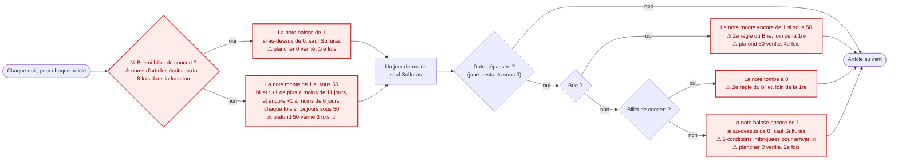
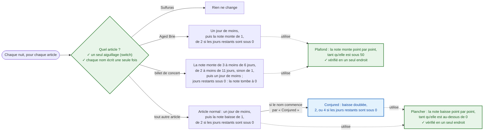

# Gilded Rose, en TypeScript

[](https://github.com/DjKhireddine/gilded-rose-typescript/actions/workflows/ci.yml)

> **En bref**
>
> - **Le point de départ** : un programme qui fonctionne, écrit par quelqu'un d'autre et difficile à
>   lire, auquel il faut ajouter une règle.
> - **Le travail** : une refacto, c'est-à-dire une transformation du code, par petites étapes,
>   qui le rend lisible sans rien changer à ce qu'il fait, puis l'ajout de la règle.
> - **Les preuves** : des tests automatiques figent d'abord ce que fait le programme ; un outil
>   sabote ensuite le code 104 fois, et chaque sabotage fait échouer au moins un test.
> - **Le résultat** : sur 581 640 nuits simulées, le nouveau code donne les mêmes résultats que
>   l'ancien, hors règle ajoutée, et chaque étape a été vérifiée.
> - **Où regarder** : les schémas [Avant, après](#avant-après), puis
>   [Vérifier par soi-même](#vérifier-par-soi-même).

Reprendre un code existant sans rien casser : figer son comportement par des tests, prouver que ces
tests protègent vraiment, transformer le code par petits pas, et seulement ensuite ajouter la
fonctionnalité demandée.

Le support de l'exercice est le kata « Gilded Rose » d'Emily Bache : la mise à jour quotidienne de
l'inventaire d'une auberge, écrite en un seul bloc de conditions imbriquées, à laquelle il faut ajouter
une règle pour les articles « Conjured ».

## Le kata

- **Source** : [emilybache/GildedRose-Refactoring-Kata](https://github.com/emilybache/GildedRose-Refactoring-Kata),
  dossier TypeScript, commit `d6407909c73b2ba61bfa7568af0d9bdce1902fd5`, importé tel quel dans le
  premier commit de ce dépôt.
- **Règles** : [GildedRoseRequirements.md](GildedRoseRequirements.md), l'original anglais, qui fait
  foi ; traduction française : [GildedRoseRequirements_fr.md](GildedRoseRequirements_fr.md).
- **Contrainte** : ne pas modifier la classe `Item` ni la propriété `items`. Elle est respectée sans
  exception. Sur ce point, la traduction s'écarte de l'original : celui-ci permet de rendre statiques
  la méthode `updateQuality` et la propriété `items` (« `Items` property »), la traduction parle de
  « propriétés dans la classe `Item` ».
- **Licence** : MIT, celle du kata ([license.txt](license.txt)).

## Lancer le projet

Avec Node 24, la version utilisée par l'intégration continue :

```sh
npm ci                     # installe les versions exactes de package-lock.json
npm test                   # golden master et tests unitaires, couverture de 100 % exigée
npm run test:mutation      # tests de mutation (Stryker), score de 100 % exigé
npm run typecheck          # TypeScript (mode strict du kata, sauf noImplicitAny)
npm run lint               # ESLint
npm run format:check       # Prettier
npm run test:comparaison   # comparaison avec le code d'origine (clone Git complet requis)
```

Le rapport détaillé des tests de mutation est écrit dans `reports/mutation/mutation.html`.

| Dossier ou fichier | Contenu |
|---|---|
| [app/gilded-rose.ts](app/gilded-rose.ts) | Le code |
| [test/jest/](test/jest/) | Le golden master et les tests unitaires |
| [test/comparaison/](test/comparaison/) | La comparaison avec le code d'origine |
| [docs/schemas/](docs/schemas/) | Les schémas « Avant » et « Après » (Mermaid, PNG, SVG) |
| [.github/workflows/ci.yml](.github/workflows/ci.yml) | L'intégration continue |

## La méthode, en quatre temps

### 1. Figer le comportement actuel

Avant de toucher au code, on enregistre ce qu'il fait, bizarreries comprises.

- **Golden master** ([golden-master.spec.ts](test/jest/golden-master.spec.ts)) : les 9 articles de
  l'inventaire d'exemple du kata vivent 30 jours, et tout ce qu'ils produisent est comparé à une
  référence enregistrée (un instantané Jest). Le moindre écart, sur n'importe quel article et
  n'importe quel jour, fait échouer le test.
- **28 tests unitaires** ([gilded-rose.spec.ts](test/jest/gilded-rose.spec.ts)) : une règle par
  test, de part et d'autre de chaque seuil (à 11 jours et à 10, à 6 et à 5, la veille de la date et
  le jour même), là où se cachent les erreurs d'un jour. Cinq d'entre eux sont marqués
  « comportement actuel » : quatre figent des cas que la spécification décrit autrement (voir
  [Écarts avec la spécification](#écarts-avec-la-spécification)), le cinquième fige le fait que
  Conjured est encore traité comme un article normal.

Les deux se complètent : hors Sulfuras, l'inventaire d'exemple ne contient aucun article au-dessus
de 50, et seuls les tests unitaires voient ce cas.

### 2. Prouver que ce filet protège

Un test qui passerait aussi avec un code faux ne prouve rien.

- **Couverture de 100 %** des lignes, branches et fonctions, exigée par la configuration de Jest :
  chaque chemin du code est parcouru par au moins un test.
- **Tests de mutation à 100 %**, avec Stryker : l'outil fabrique des versions sabotées du code
  (un `<` changé en `<=`, une condition remplacée par `true`, un bloc vidé) et relance les tests
  sur chacune. Chaque sabotage doit faire échouer au moins un test. Code d'origine : 104 sabotages,
  tous détectés. Code final : 69, tous détectés.

### 3. Outiller avant de transformer

Toujours sous la protection du filet : un seul outil de test (Jest), TypeScript 5.9 avec le mode
strict du kata (sans `noImplicitAny`, qui obligerait à typer la classe `Item`), ESLint (règles
strictes de typescript-eslint, `any` explicite interdit), Prettier, et une intégration continue
GitHub Actions qui relance tout, mutation comprise, à chaque envoi.

### 4. Transformer par petits pas, puis ajouter Conjured

La refacto tient en neuf pas, entre les étiquettes `avant-refacto` et `apres-refacto` : extraire le
traitement d'un article, nommer les articles spéciaux, sortir Sulfuras en premier, regrouper la
règle du Brie puis celle du billet, rassembler les bornes 0 et 50, remplacer les bonus du billet par
une table de gains, aiguiller par un `switch`, écrire le passage d'un jour avec `--`. Chaque pas ne
fait qu'une chose et laisse tout au vert, mutation comprise.

Conjured arrive ensuite, test d'abord : cinq tests écrits et vus en échec dans un premier commit
(marqués `it.failing`), le code au commit suivant. Le premier commit ajoute aussi un contre-exemple,
vert avant comme après, et retire le test « comportement actuel » de Conjured : 33 tests unitaires
aujourd'hui, 34 tests avec le golden master.

## Avant, après

### Avant : le chemin de décision du code d'origine

En rouge, les problèmes : noms d'articles écrits en dur 8 fois, plafond de 50 vérifié à 4 endroits et
plancher de 0 à 2, règles du Brie et du billet coupées en deux, jusqu'à 5 conditions imbriquées.



### Après : une règle par article

En vert, ce que la refacto a réglé ; en bleu, la nouvelle règle Conjured.



Les mêmes schémas en image : [avant.png](docs/schemas/avant.png) et
[apres.png](docs/schemas/apres.png).

## Décisions, et ce qui a été écarté

- **Laisser la classe `Item` intacte**, comme le demande le kata. TypeScript garde donc le réglage du
  kata, `noImplicitAny: false`, sans lequel il refuserait les paramètres sans type de son
  constructeur. *Écarté* : typer ces trois paramètres pour activer `noImplicitAny`, ce qui aurait
  modifié la classe.
- **Seuils du billet écrits `< 11` et `< 6`, comme dans le code d'origine.** Une refacto ne change
  rien, même là où personne ne regarde : `<= 10` et `<= 5` sont identiques pour des jours entiers,
  pas pour des demi-journées, que le code accepte. *Écarté* : `<= 10` et `<= 5`, plus proches des
  mots de la spécification.
- **Bornes appliquées point par point**, dans `increaseQuality` et `decreaseQuality`. C'est la
  seule écriture, sur cinq essayées, qui passe à la fois les tests, la mutation à 100 % et la
  comparaison avec le code d'origine. *Écartés* : un plafond appliqué après l'ajout (`Math.min`, ou
  `if (q > 50) q = 50`), qui ramène à 50 un article déjà au-dessus (deux tests échouent) ; le même
  plafond précédé d'une garde, qui vérifie la borne deux fois et laisse des sabotages qu'aucun test
  ne peut voir ; `Math.max` puis `Math.min`, qui diverge sur les demi-points.
- **Un `switch` sur le nom de l'article**, l'article normal en `default` : une règle par type
  d'article, lue comme un sommaire. *Écarté* : une classe par type d'article, beaucoup de code pour
  quatre règles alors qu'`Item` est intouchable.
- **Conjured reconnu au début du nom** : la spécification parle d'un fournisseur, donc d'une
  famille d'articles. C'est une hypothèse, figée par un test (« Conjured Sword ») et un
  contre-exemple (« Elixir of the Conjured » reste un article normal). *Écarté* : le nom exact de
  l'article d'exemple.
- **Conjured après sa date : 4 points par nuit.** La spécification dit « deux fois plus vite que les
  objets normaux » ; un article normal perd 2 points par nuit une fois sa date passée, un Conjured
  en perd donc 4. C'est une lecture de la spécification, une hypothèse à confirmer par le métier.
  Ambiguïté signalée : un « Conjured Aged Brie » commence par « Conjured » et il est traité comme
  tel, il perd donc en qualité, alors qu'un Brie se bonifie. La spécification ne tranche pas.

## Écarts avec la spécification

La refacto conserve le comportement du code d'origine, y compris là où il s'écarte de la
spécification. Corriger ces écarts serait une décision métier, pas un nettoyage : chacun est figé
par un test, qu'il suffira de modifier si la décision est prise.

- **Qualité au-dessus de 50.** La spécification dit « jamais plus de 50 ». Le code ne vérifie le
  plafond que quand la qualité monte : un Brie ou un billet à 60 reste à 60, un article normal à 60
  passe à 59. Tests marqués « comportement actuel ».
- **Qualité négative.** La spécification dit « jamais négative ». Le code ne retire un point que si
  la qualité est au-dessus de 0, mais ne remonte pas une qualité déjà négative : un article normal
  à -5 reste à -5. Test marqué « comportement actuel ». La refuser à l'entrée, dans le constructeur
  de `GildedRose`, ne suffirait pas : la liste `items` et les propriétés d'`Item` restent publiques,
  et le kata interdit d'y toucher. Une qualité négative pourrait donc être écrite après coup.
- **Brie après sa date.** Il gagne 2 points par nuit une fois sa date passée ; la spécification ne
  le dit pas.
- **Chute du billet.** La spécification dit « après le concert ». Le code décompte le jour avant de
  regarder la date : la qualité tombe à 0 dès la nuit où les jours restants passent de 0 à -1.

## Laissé de côté

- **Compilation vers ES5**, réglage hérité du kata. `startsWith`, plus récent, passe la
  vérification des types parce que les types de Node (`@types/node`) déclarent les versions récentes
  de JavaScript, et Node 24 l'exécute. Changer de cible serait un changement d'outillage à part.
- **Qualité NaN ou infinie.** Seule différence de comportement de la refacto, hors Conjured : un
  billet après le concert passait à NaN avec ces valeurs, il passe maintenant à 0
  (`quality = 0` au lieu de `quality - quality`). Elles n'ont pas de sens pour une qualité.
- **La comparaison avec le code d'origine reste hors de l'intégration continue.** C'est un outil de
  refacto, pas une règle permanente : le code d'origine cesse d'être la référence dès qu'un
  comportement change volontairement, comme pour Conjured. Dans l'intégration continue, elle
  bloquerait ces évolutions.
- **La mutation à chaque envoi** n'est raisonnable que parce qu'elle prend quelques secondes ici.
  Sur un projet plus gros, elle tournerait en mode incrémental sur les fichiers modifiés, et en
  entier chaque nuit.
- **La limite des preuves.** Une mutation à 100 % prouve que les tests détectent tout changement du
  code, pas que ce code est juste : elle fige aussi les écarts listés plus haut.

## Vérifier par soi-même

- **Les tests n'ont pas été retouchés pendant la refacto.**

  ```sh
  git log --oneline avant-refacto..apres-refacto -- test/
  ```

  La commande n'affiche aucun commit : aucun ne touche aux tests entre les deux étiquettes, et
  `git diff avant-refacto apres-refacto -- test/` est vide.
- **La référence du golden master n'a changé qu'une fois, pour Conjured.**

  ```sh
  git log --oneline -- test/jest/__snapshots__/
  ```

  `git show cf939e0 -- test/jest/__snapshots__/` montre que seules les lignes de Conjured Mana Cake
  ont changé.
- **Le nouveau code donne les mêmes résultats que l'ancien**, Conjured mis à part, sur 581 640 nuits
  qui incluent demi-journées, demi-points et valeurs hors bornes : `npm run test:comparaison`.
- **Chaque commit a été vérifié** par l'intégration continue depuis son arrivée (`e07f13b`) : onglet
  Actions du dépôt. Les commits précédents ont été rejoués un à un en local.

## Lire l'historique

L'historique raconte la démarche : un commit par pas, avec un message qui dit le pourquoi et les
essais écartés.

| Étape | Commits |
|---|---|
| Importer le kata à l'identique, cartographier le code | `bef26ad` à `6f4843a` |
| Figer le comportement | `89329fe` à `6a2a383` |
| Prouver le filet par la mutation | `a93e664` |
| Outiller | `190a70e` à `e07f13b` (étiquette `avant-refacto`) |
| Transformer | `ca697e5` à `525566b` (étiquette `apres-refacto`) |
| Ajouter Conjured, test d'abord, et dessiner le schéma « Après » | `5f47ced` à `046b183` |
| Rendre la comparaison vérifiable, écrire ce README | `c46d5f8` et le commit de ce README |

Le premier commit est volontairement rouge : il importe le kata sans rien changer, y compris son
test d'exemple, qui échoue par construction. Il sert de point de départ, et la suite repasse au vert
au commit suivant.
